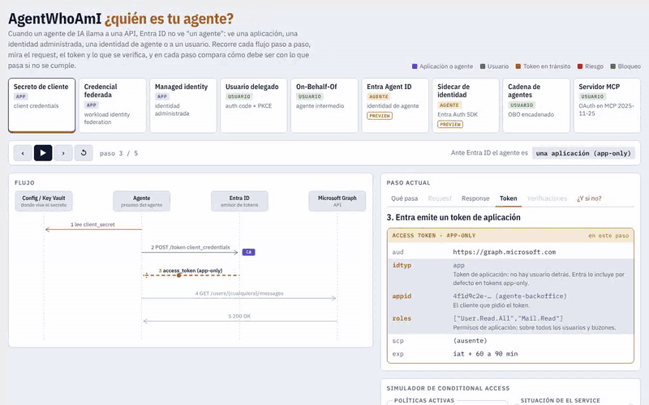

# AgentWhoAmI

Un mapa interactivo de cómo se autentica un agente de IA en Microsoft Entra ID, método por método, con dos lecturas en cada paso: cómo debe ser y qué pasa si no.

Cuando un agente llama a una API, Entra ID no ve "un agente". Ve una aplicación, una identidad administrada, una identidad de agente o a una persona. Esa elección define qué token recibe, qué controles se le pueden aplicar y hasta dónde llega si alguien lo manipula.

## Inicio rápido

**Pruébalo en línea:** https://0xaf00.github.io/AgentWhoAmI/

O úsalo sin conexión:

1. Descarga `index.html`.
2. Ábrelo en cualquier navegador.

Es un solo archivo, sin build y sin llamadas a APIs. Trae su propia Content-Security-Policy (`default-src 'none'`, `connect-src 'none'`); lo único externo que carga son las fuentes de Google Fonts, y si no cargan la página usa las del sistema.

## Métodos

| # | Método | Qué muestra |
|---|--------|-------------|
| 1 | Secreto de cliente | Client credentials con un secreto guardado. Token de aplicación con roles sobre todo el tenant. |
| 2 | Credencial federada | Workload identity federation: la app confía en un emisor externo y no guarda secreto. |
| 3 | Managed identity | La plataforma entrega el token por IMDS. Sin secreto, pero sin Conditional Access. |
| 4 | Usuario delegado | Auth code con PKCE. El token lleva al usuario y el permiso efectivo es la intersección de scopes y permisos del usuario. |
| 5 | On-Behalf-Of | Un agente intermedio canjea el token del usuario por uno para la API de abajo. |
| 6 | Entra Agent ID (preview) | Blueprint, identidad de agente y cuenta de usuario del agente, en sus tres modos: autónomo, en nombre de un usuario y como usuario del agente. |
| 7 | Sidecar de identidad | Microsoft Entra ID Auth SDK como contenedor junto al agente: el agente pide el encabezado y nunca ve la credencial. |
| 8 | Cadena de agentes | Orquestador y especialista con OBO en cada salto y validación de audiencia. |
| 9 | Servidor MCP | Autorización de MCP 2026-07-28 (metadata RFC 9728, PKCE, `resource`, validación de `iss` según RFC 9207), con la variante prohibida de reenvío de token. |

## Qué trae cada método

- **Diagrama de secuencia** paso a paso, con el request, la respuesta y los claims del token.
- **Verificaciones**: qué debe validar cada parte, cómo debe ser y qué pasa si no se hace.
- **Simulador de Conditional Access**: activa políticas y cambia el contexto (MFA, dispositivo, red, riesgo) para ver si el token se emite o el flujo se corta con su código AADSTS. Muestra cuándo una identidad no tiene evaluación posible.
- **Radio de impacto** ante tres ataques: prompt injection, filtración de la credencial y robo de un token en tránsito.
- **Dónde queda el rastro**: tablas de Log Analytics y consultas KQL listas para copiar.
- **Matriz comparativa** y tablas de referencia de claims y errores frecuentes.

## Datos de ejemplo

Los identificadores, usuarios y dominios de los ejemplos son ficticios (`contoso-lab`).

## Próximamente

Un laboratorio en Azure que ejecuta el mismo agente con cada identidad y publica la evidencia real, sanitizada: claims de los tokens, sign-in logs y respuestas 200 y 403.

## Licencia

MIT. Ver [LICENSE](LICENSE).
